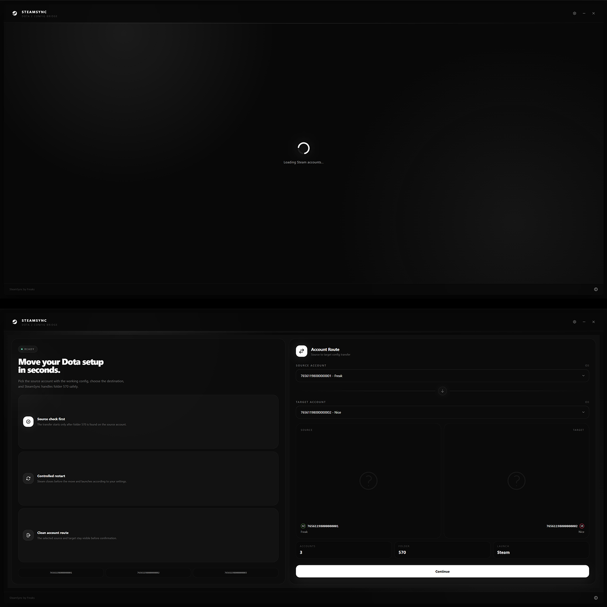
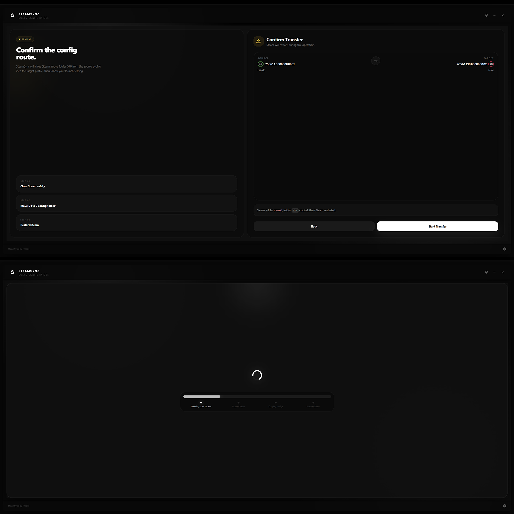
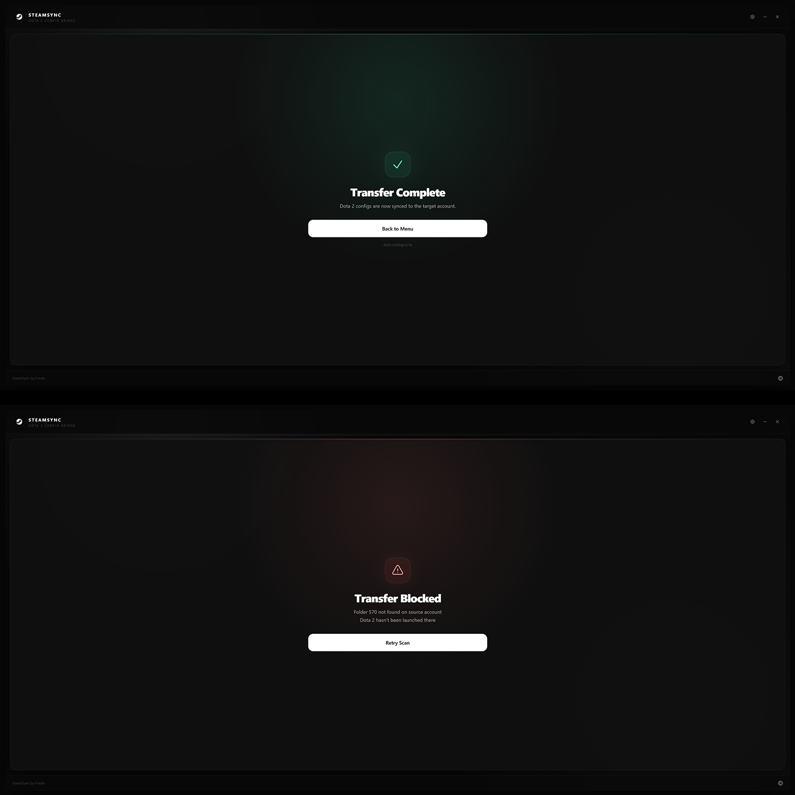

## Возможности

- **Автоопределение Steam** — находит папку Steam на любом диске: конфиг → реестр (HKCU/HKLM) → запущенный процесс → скан всех разделов C:–Z:
- **Выбор библиотеки** — если найдено несколько мест со Steam, выбирается то, где есть данные Dota 2 (папка `570`)
- **Ручной выбор папки** — если Steam не найден автоматически, можно указать папку вручную (путь сохраняется)
- **Подгрузка профилей** — никнейм, аватар и уровень Steam (реальные иконки уровней) для каждого аккаунта
- **Поиск аккаунтов** — быстрый фильтр по нику и ID3
- **Перенос конфигов** — копирует папку `570` (настройки, хоткеи, бинды, cloud) с прогрессом по файлам и байтам
- **Умный запуск после переноса** — Steam / Secret DLC (Umbrella) / Custom app / ничего. Путь для каждого режима определяется автоматически и может быть изменён
- **Steam** — автоматически закрывает и перезапускает Steam во время переноса
- **Umbrella** — поддержка лоадера из `C:\Umbrella` и `C:\umb`
- **Локализация** — English / Русский

---

## Скриншоты







---

## Установка

### Готовая сборка

Готовая portable-версия (`SteamSync.exe`) доступна в разделе [Releases](https://github.com/f4stdebug/sync/releases).

### Сборка из исходников

**Требования:**
- [Node.js](https://nodejs.org/) 18+
- npm 9+

```bash
# 1. Клонируем репозиторий
git clone https://github.com/f4stdebug/sync.git
cd sync

# 2. Устанавливаем зависимости
npm install

# 3. Режим разработки (горячая перезагрузка)
npm run dev

# 4. Собираем portable .exe
npm run release
```

После `npm run release` готовый файл `SteamSync 1.0.3.exe` появится в папке `dist/`.

---

## Как пользоваться

1. Запусти SteamSync
2. Приложение само просканирует все Steam-аккаунты и загрузит их профили
3. В левой колонке выбери **Source Account** (откуда берём конфиги)
4. В правой колонке выбери **Target Account** (куда переносим)
5. Нажми **Continue** — приложение проверит наличие папки 570
6. Подтверди перенос на экране **Confirm Transfer**
7. SteamSync закроет Steam, скопирует папку 570, запустит Steam (или выбранное приложение)

---

## Настройки

Сохраняются в `%APPDATA%/steamsync/steamsync_settings.json`:

| Ключ | Описание |
|------|----------|
| `launchMode` | Что запускать после переноса: `steam` / `umbrella` / `custom` / `none` |
| `steamPath` | Путь к папке Steam (если выбран вручную) |
| `steamExe` | Кастомный путь к `Steam.exe` |
| `umbrellaExe` | Кастомный путь к лоадеру Umbrella |
| `customPath` | Путь к произвольному `.exe` для режима Custom |
| `lang` | Язык интерфейса: `en` / `ru` |

---

## Changelog

### 1.0.3
- Автопоиск Steam на любых дисках (реестр, процесс, скан разделов)
- Умный выбор библиотеки с Dota 2
- Ручной выбор папки Steam
- Прогресс копирования по файлам/байтам
- Поиск аккаунтов
- Умный запуск после переноса + настройка путей для каждого режима
- Локализация EN/RU

### 1.0.2
- Multi-SSD автопоиск Steam

### 1.0.1
- Исправлен запуск Umbrella

---

## Связь

- Telegram: [@steamsync](https://t.me/steamsync)
